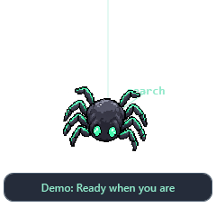

# Webby — OpenCode Spider

A small **OpenCode v2** desktop companion for Windows. A mint-eyed pixel spider hangs from a silk thread at the top edge, or perches above the taskbar. No enclosing card, permanent title bar, or taskbar button.


## Install as an OpenCode v2 plugin

1. Download the Windows ZIP from [Releases](https://github.com/kadiryurekturk/webby-opencode/releases) or clone the repository, and keep it in a permanent folder such as `C:/Tools/webby-opencode`.
2. Add that **directory** to the `plugins` array in the project's `opencode.json`, or in `%USERPROFILE%\.config\opencode\opencode.json` for global use. Create the file if needed; keep existing settings and plugins:

```json
{
  "plugins": ["C:/Tools/webby-opencode"]
}
```

Replace the path with the folder containing `index.js` and `Spider.ps1`. Use forward slashes or escaped backslashes in JSON. Restart OpenCode after editing the configuration. Webby starts when the plugin loads; no separate CMD or server password is needed. OpenCode Desktop loads globally configured server plugins; CLI project configuration applies to that project.

The Windows plugin starts the WPF companion as its child and subscribes to the v2 event API over an in-memory local pipe. OpenCode may keep its shared server running after a TUI closes, so Webby follows the plugin/server lifetime, not necessarily one terminal window. Quit using the tray menu or unload the plugin to stop it. Exit an older standalone/demo instance before enabling the plugin: only one desktop instance runs at a time. If multiple locations load the plugin, the first active instance owns the desktop mascot.

This is a local-directory plugin, not an npm-published package. Its dependency-free v2 `{ id, setup }` object is equivalent to `Plugin.define` and avoids local `@opencode/plugin` resolution failures in some releases. See the [v2 server plugin documentation](https://opencode.ai/v2/docs/build/plugins/server/) and [v2.2.0 test plugin](https://github.com/anomalyco/opencode/blob/v2.2.0/packages/server/test/fixture/worktree-plugin/index.ts).

## Standalone and demo

`Start-Spider.cmd` remains available for standalone use. Right-click the spider or its system tray icon and choose **Choose project folder...** for the terminal-launch action.

**Demo.cmd** cycles through the visual states without connecting to OpenCode. If Webby is already running, exit it from the tray before starting the demo; only one interactive instance runs at a time.

**Requirements:** Windows 10/11 desktop, built-in **Windows PowerShell 5.1**, WPF/.NET Framework, and OpenCode v2 for live status. No Python, Node.js, Electron, npm packages, or separate compiler installation is required for Webby. Its small C# helpers compile in memory using `Add-Type`.
Use `powershell.exe`, not PowerShell 7. Organizational restrictions on PowerShell or `Add-Type` may prevent startup.

## Standalone connection

By default, Webby reads the OpenCode v2 service registration at:

```text
%USERPROFILE%\.local\state\opencode\service.json
```

If `XDG_STATE_HOME` is set, it uses `XDG_STATE_HOME/opencode/service.json` instead. It reads the loopback URL and server password into memory, then observes the native `/api/event` SSE stream. The registration is checked every three seconds, so an OpenCode restart or port change can be picked up automatically. Webby never edits this file.

**A separate `opencode serve` command is no longer required for the normal v2 background-service workflow.** OpenCode must still have a running service. An isolated `--standalone` session, WSL-only instance, custom registration path, or incompatible service registration may need explicit configuration.

```powershell
# Optional custom service registration:
.\Start-Spider.cmd -ServiceFile "C:\path\to\service.json"
# Optional project for newly launched terminals:
.\Start-Spider.cmd -ProjectDirectory "C:\projects\my-app"
```

For a manually started local server, set its credentials in Windows PowerShell and pass the address explicitly:

```powershell
$credential = Get-Credential -UserName opencode -Message 'Enter your OpenCode server password'
$env:OPENCODE_PASSWORD = $credential.GetNetworkCredential().Password
.\Start-Spider.cmd -ServerUrl http://127.0.0.1:4096
```

Use `OPENCODE_SERVER_USERNAME` only if your server uses another username. Webby accepts loopback HTTP(S) server roots only and does not follow redirects. Credentials are never written to Webby's settings or logs.

## Interactions

| Action | Result |
| --- | --- |
| Click the spider | Bring an eligible OpenCode window forward, or open a new OpenCode terminal in the selected project |
| Drag toward the upper half of a screen | Snap to the top edge and hang from silk |
| Drag toward the lower half | Perch above that screen's taskbar/work-area edge |
| Hover | Reveal the short status bubble and interaction hint |
| Right-click spider or tray icon | Open controls |
| Show / hide Webby | Hide the mascot while retaining the tray icon and status tracking |
| Reduce motion | Stop the gentle sway/bob without stopping event tracking |
| Start with Windows | Opt in or out by creating/removing Webby's own Startup shortcut |
| Exit Webby | Stop the connection and remove the tray icon |

Position, docking mode, selected project, reduced motion, and always-on-top preferences are stored under `%LOCALAPPDATA%\Webby`. Startup is **off by default**. The startup shortcut launches normal automatic-discovery mode; explicit server credentials are not persisted. Keep the extracted folder in place after enabling startup.

Click-to-focus is best effort: it looks for a visible terminal/OpenCode process whose window title contains `OpenCode`. It cannot select a specific hidden Windows Terminal tab or reliably infer which session you intended. If no eligible window can be focused, it launches `opencode` in Windows PowerShell. This feature is window-level, not per-session navigation.

## Quiet, useful status

### Catching words with silk

While OpenCode works, Webby casts a short silk line toward a nearby word, then reels it into the sprite. Only one word appears at a time: each capture takes 1.8 seconds, with at least four seconds between casts. A small knot briefly appears on completion.



Webby also takes short words from assistant response text events (`session.text.delta`). When no response word is pending, fixed activity labels such as `read`, `search`, and `think` can appear. Words are transient in memory and may be visible to anyone watching your screen; they are not written to disk. Avoid using this feature where response text must remain hidden from bystanders.

No screen scraping, OCR, file paths, or command arguments are used. The animation works with TUI or GUI sessions that share the connected OpenCode v2 server; it does not extract words from their on-screen positions. Permission waits, disconnects, reduced motion, dragging, and hiding the mascot cancel the effect. Demo mode continuously shows example response words; right-click to reduce motion.

- **Ready when you are:** connected and listening; the bubble disappears after a few seconds.
- **Weaving code...:** faster gentle motion while a session works; hover to read the status.
- **Permission needed:** an amber text bubble stays visible until the request is resolved in OpenCode.
- **All done! / Something went wrong:** completion or failure appears for eight seconds.
- **Click to open OpenCode:** disconnected; the sprite dims and the connection retries automatically.

The mascot does not move across your work on its own or take keyboard focus when status changes. Waiting for permission takes priority over other active sessions. Windows' animation preference is respected on startup. Motion uses a small sprite transform, not separately animated legs or a walking simulation.

## Limits and privacy

Webby is an independent community project, not an official OpenAI or OpenCode mascot. It reads events, does not approve permissions or submit agent prompts, and sends no telemetry. Clicking explicitly opens or focuses OpenCode. No database timestamps are used to guess whether the agent is working.

Open Webby before starting work: the stream does not replay missed events. Work already in progress at connection time, and events during disconnection, are not reconstructed. Ready means listening for new events, not a verified idle server. OpenCode question forms are not yet handled.

Local preferences contain your selected project path. `%LOCALAPPDATA%\Webby\webby.log` contains bounded, generic application diagnostics, never conversation content or server credentials. To remove automatic startup, uncheck **Start with Windows** before deleting the extracted folder.

## Verification

The event contract targets **OpenCode v2**. OpenCode **v2.2.0** loaded the local plugin and launched the Windows companion in an integration check. The original authenticated standalone SSE integration was also checked with v2.2.0. No paid model run or live TUI/GUI response animation was exercised.

```powershell
# State transitions, discovery, URL validation, docking and preferences:
powershell.exe -NoProfile -File tests/state.tests.ps1
# SSE framing and disconnect handling:
powershell.exe -NoProfile -File tests/stream.tests.ps1
# Native WPF startup, both layouts and isolated click route:
powershell.exe -NoProfile -STA -File Spider.ps1 -Demo -SmokeTest
# Optional local integration test; requires the v2.2.0 test binary in .tools/package/bin:
powershell.exe -NoProfile -File tests/plugin-live.tests.ps1
```

State/SSE tests, plugin-mode WPF smoke, and the v2.2.0 plugin load test passed. Live click-to-focus, startup-shortcut activation, and mixed-DPI multi-monitor interaction were not exercised. The UI smoke test avoids changing user settings or launching terminals. Other v2 releases must expose the same event contract.

References: [v2 HTTP API](https://opencode.ai/v2/docs/api), [v2.2.0 session events](https://github.com/anomalyco/opencode/blob/v2.2.0/packages/schema/src/session-event.ts), [permission events](https://github.com/anomalyco/opencode/blob/v2.2.0/packages/schema/src/permission.ts), [service registration schema](https://github.com/anomalyco/opencode/blob/v2.2.0/packages/client/src/service.ts).

## Source layout

- `Spider.ps1`: transparent WPF companion, animations and tray controls.
- `src/State.ps1`: event-to-status reducer.
- `src/Activity.ps1`: fixed activity vocabulary, animation timing and cooldown.
- `src/Desktop.ps1`: service discovery, docking and local preferences.
- `src/Native.cs`: Windows foreground-window helper.
- `src/Launch-OpenCode.ps1`: explicit user-requested terminal launch.
- `src/EventStream.cs`: background SSE transport.
- `index.js` and `src/PluginStream.cs`: v2 plugin lifecycle and local event pipe.
- `assets/webby.png`: generated transparent pixel sprite.

MIT licensed.
