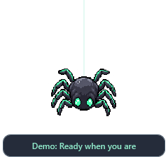

# Webby — OpenCode Spider

A tiny digital ASCII spider companion for **OpenCode v2**, living on your Windows desktop.
It animates while your agent works, gets your attention when permission is needed, and celebrates completed tasks.



## Quick start

1. Download the Windows ZIP from [Releases](https://github.com/kadiryurekturk/webby-opencode/releases) and extract it into a folder.
2. Double-click **Demo.cmd** to preview every state without running OpenCode.
3. Connect to your OpenCode server for live status updates using the instructions below.

**Requirements:** Windows 10/11 desktop, built-in **Windows PowerShell 5.1**, and WPF/.NET Framework.
No Node.js, Python, Electron, npm packages, or separate build tools are required for the companion. The C# network helper is compiled in memory at startup using the compiler included with Windows.
Use `powershell.exe`, rather than PowerShell 7. Organizational policies that block PowerShell or `Add-Type` may prevent the app from running.

## Connect to OpenCode

First, open a terminal in your project directory:

```powershell
opencode serve --hostname 127.0.0.1 --port 4096
```

OpenCode prints the local server address and server password at startup.
Open a second **Windows PowerShell** window in the Webby folder:

```powershell
$credential = Get-Credential -UserName opencode -Message 'Enter your OpenCode server password'
$env:OPENCODE_PASSWORD = $credential.GetNetworkCredential().Password
.\Start-Spider.cmd
```

This is the server password, not your model provider's API key. Webby does not save it to disk.
If your server uses a different username, set `OPENCODE_SERVER_USERNAME`.
For a different port, run `.\Start-Spider.cmd -ServerUrl http://127.0.0.1:4097`.

Connect the OpenCode TUI to the **same server**:

```powershell
opencode --server http://127.0.0.1:4096
```

Run this command in the terminal where you set `OPENCODE_PASSWORD`. An independent `opencode` instance using its own server will not send events to this connection.
For servers without authentication, launch `Start-Spider.cmd` directly.

## Controls and states

- **Drag:** move the companion.
- **Right-click:** pause animation, toggle always-on-top, or close.
- **× / Escape:** close. Webby also appears in the taskbar.
- **READY:** connected and listening for new events.
- **WEAVING CODE:** at least one session is working.
- **NEEDS YOU:** a permission request is pending; respond inside OpenCode.
- **ALL DONE / SNAG IN THE WEB:** completion or failure, shown for 8 seconds before returning to the normal state.
- **OFFLINE:** the server is unavailable or access failed; Webby reconnects automatically. Hover over the companion for connection details.

Multiple sessions are tracked, with pending permissions taking priority over active work.
Pausing animation does not pause status updates. Demo mode cycles through states every 4 seconds.

## Scope and privacy

Webby is an independent community project, not an official OpenAI or OpenCode mascot.
It **only reads** the local v2 `/api/event` SSE stream. It does not execute agent commands, approve permissions, save conversation content, or send telemetry.
It connects only to loopback addresses and does not follow redirects that could forward credentials elsewhere.

Start Webby before starting your work. The event stream does not replay history: work that started before connection and events missed during a disconnection are not reconstructed. After reconnecting, READY means Webby is listening for new events; it does not mean the entire server is idle.
This version supports permission alerts. OpenCode question forms, click-to-focus sessions, a system tray icon, and automatic startup are not included.

## Compatibility and verification

Designed for **OpenCode v2**, using its native event API. The authenticated SSE connection and WPF window startup/shutdown were verified on Windows with **OpenCode v2.2.0**. Other v2 releases have not been individually verified and must expose the same event contract.
State transitions are covered by deterministic tests. An end-to-end agent run requiring paid model calls has not been performed.

Event contract references:

- [v2 HTTP API](https://opencode.ai/v2/docs/api)
- [Session events in the tested v2.2.0 release](https://github.com/anomalyco/opencode/blob/v2.2.0/packages/schema/src/session-event.ts)
- [Permission events in the tested v2.2.0 release](https://github.com/anomalyco/opencode/blob/v2.2.0/packages/schema/src/permission.ts)

```powershell
powershell.exe -NoProfile -File tests/state.tests.ps1
powershell.exe -NoProfile -File tests/stream.tests.ps1
powershell.exe -NoProfile -STA -File Spider.ps1 -Demo -SmokeTest
# Requires a running server with credentials set in the environment:
powershell.exe -NoProfile -File tests/live.tests.ps1 -ServerUrl http://127.0.0.1:4096
```

Source layout: `Spider.ps1` contains the interface, `src/State.ps1` handles state transitions, and `src/EventStream.cs` manages the background connection.
Released under the MIT license.
